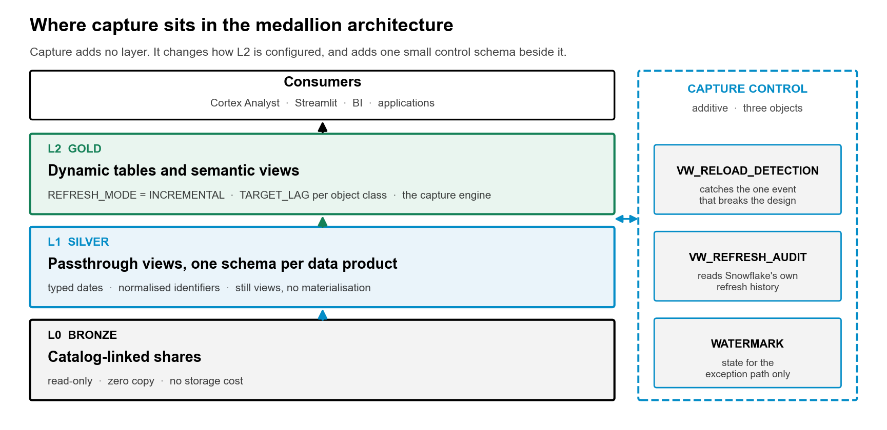
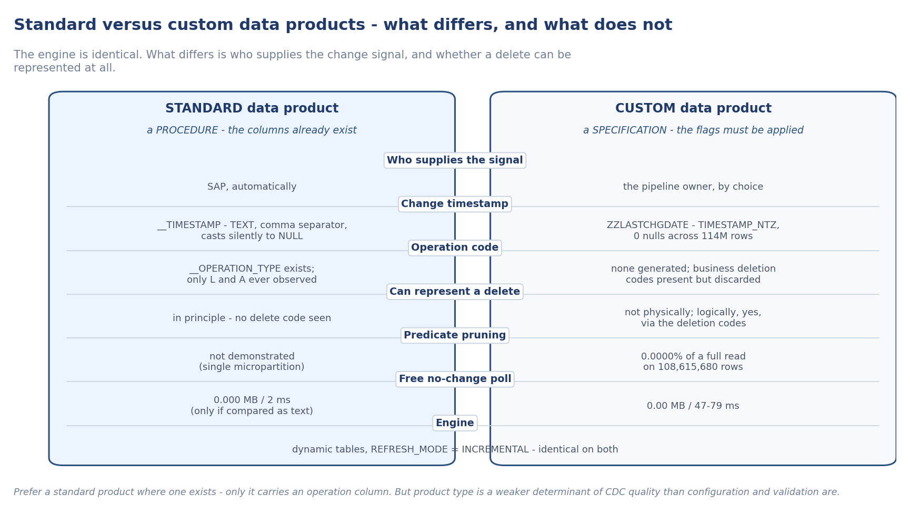
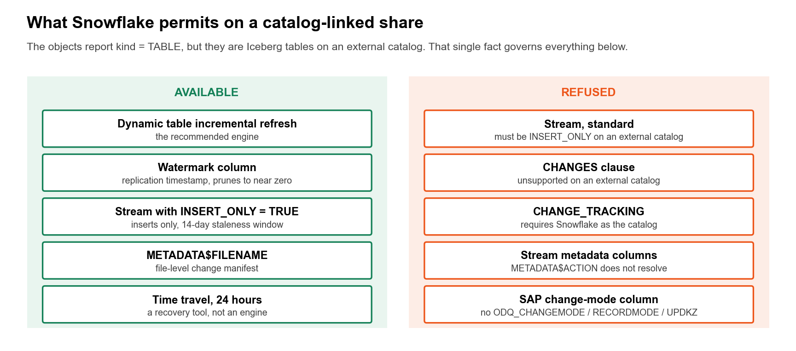
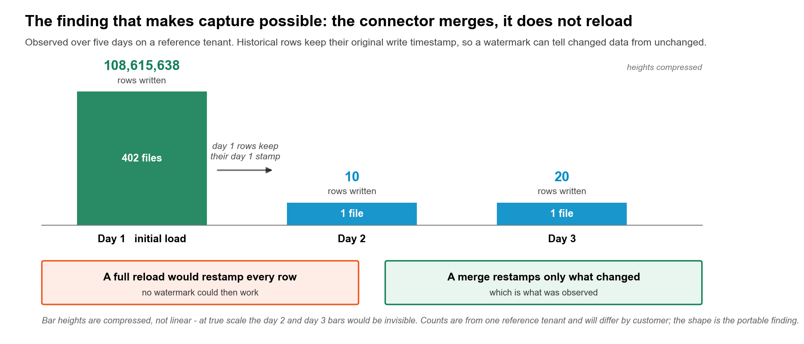
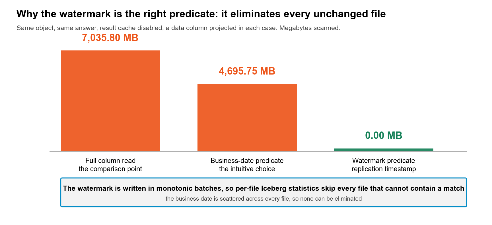
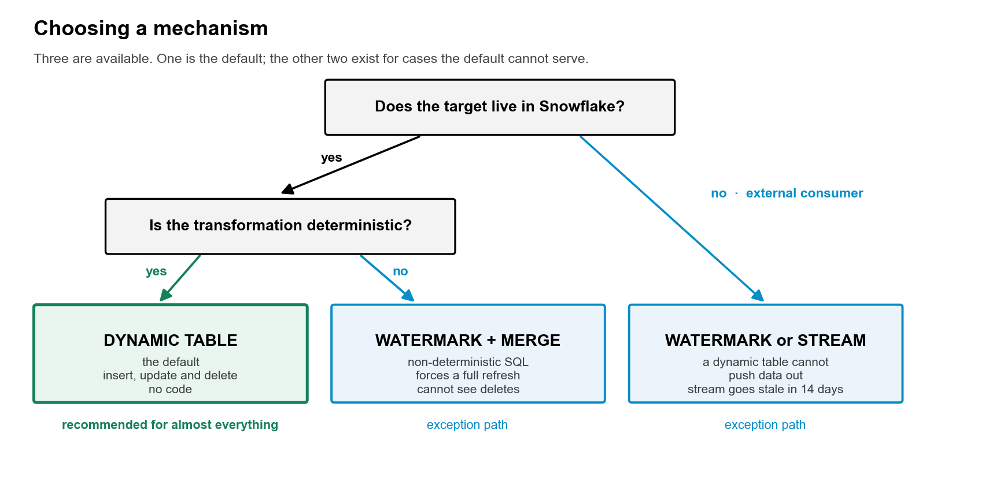
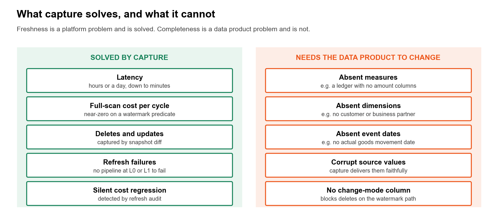

# Change Data Capture from SAP BDC catalog-linked shares

Incremental capture from SAP Business Data Cloud data products shared into Snowflake as
catalog-linked (zero-copy) databases — without copying the share, and without building an
engine.

**The short version:** it works, and the mechanism is a platform feature rather than
something you write. Dynamic tables refresh incrementally over a catalog-linked share and
detect no-change in a few hundred milliseconds. A replication watermark is available for the
cases dynamic tables cannot serve. Streams, `CHANGES()` and change tracking are all refused
**directly on the share objects**, for one reason that explains most of this repository: they
are Iceberg tables on an external catalog. That refusal is not the end of the story — put a
dynamic table over the share and a standard stream on *that*, and you get a real change feed
with deletes. See [the interposition that works](docs/how-it-works.md#the-interposition-that-does-work-a-stream-on-a-dynamic-table).

**There are two tracks, and which one you get is decided by SAP, not by you.** Standard data
products arrive with change metadata that SAP generates. Custom data products carry only
whatever change timestamp the pipeline owner chose to expose. The signals are not
interchangeable — one can represent a delete and the other cannot — so the first job is to
find out which you have, per object. The probe does that. (Which track you are on decides what
the *source signal* can express; it does not decide whether you can detect deletes at all —
the dynamic table plus stream does that on either track.)



---

## Which track do you have — and where to go



| | Standard data products | Custom data products |
| --- | --- | --- |
| Who provides the signal | SAP, automatically | your pipeline owner, by choice |
| Change timestamp | `__TIMESTAMP` (TEXT, comma decimal separator) | e.g. `ZZLASTCHGDATE` (TIMESTAMP_NTZ) |
| Operation column | `__OPERATION_TYPE` | none |
| Batch context | `load_type_<hash>`, `run_id_<hash>` | none |
| Can represent a delete | structurally yes — unverified in practice | no — but see note below |
| First step | validate the metadata — it can be silently corrupted on copies | identify which capabilities the share carries |
| **Your document** | **[docs/standard-products-cdc.md](docs/standard-products-cdc.md)** — a numbered procedure to follow | **[docs/custom-products-cdc.md](docs/custom-products-cdc.md)** — a specification of what to ask for |

Both tracks share the same engine — dynamic tables with `REFRESH_MODE = INCREMENTAL` — and the same constraint that streams, `CHANGES()`, and change tracking are all refused *on the share objects themselves*. [docs/how-it-works.md](docs/how-it-works.md) covers the common mechanism. The two documents above cover what is different.

**Note on deletes.** The table above describes what the *source signal* can express. It is not a statement about what you can detect. A dynamic table over the share detects physical deletes on either track by diffing snapshots, and a standard stream on that dynamic table exposes them as `DELETE` records — so the custom track's missing operation column is not a barrier to delete handling. The one thing no track gives you is a reliable update *flag*: `METADATA$ISUPDATE` is always `FALSE`, and an update arrives as a `DELETE` + `INSERT` pair. Field-validated with a customer; details and the MERGE pattern are in [how-it-works.md](docs/how-it-works.md#the-interposition-that-does-work-a-stream-on-a-dynamic-table).

Run the readiness probe first regardless of track. It classifies every object, validates standard metadata, and confirms the mechanisms work on your specific tenant before you deploy anything.

---

## Is this you?

You have one or more SAP BDC data products linked into a Snowflake account, and:

- consumers complain the data is hours or a day behind
- your Gold layer re-reads the whole share on a schedule because nothing tells it what changed
- you are about to write a custom CDC framework, and want to know whether you need to

If so, start with the readiness assessment. It takes a minute and answers the question for
*your* tenant rather than in general.

```bash
cd probes
pip install -r requirements.txt
python3 cdc_readiness.py --connection <your_connection> --report readiness.md
```

Add `--with-scratch-tests` to prove the mechanisms rather than infer them. That creates a
stream and a dynamic table in a scratch database and drops them; everything else is read-only.

Sample output, from an account that happens to hold both kinds of product at once:

```
[  ok  ] share.present: 8 catalog-linked database(s)
[  ..  ] share.inventory: 47 objects, 853 columns
[ warn ] share.uninitialized: 1 of 47 objects could not be described
[  ok  ] signal.standard: 7 object(s) carry connector metadata columns (7 with a flow
         hash), 1 custom-track, 38 with no signal.
[  ..  ] semantics.operation: Across 5 object(s): L=67,087, A=393. No delete code
         observed.
[  ok  ] semantics.load_type: Across 5 object(s): initial=67,087, delta=393. Both a
         snapshot and deltas are present, so the connector appends changes.
[  ok  ] semantics.trustworthy: All 5 standard object(s) passed: the operation column
         holds short codes, timestamps parse, and no column is duplicated.
[  ok  ] cost.poll: MAX on the raw text is answered from manifest statistics without
         reading data.

VERDICT: READY WITH CAVEATS
```

On a pure custom-track account the same probe reports `signal.watermark: Replication
timestamp present on all 23 objects (column: ZZLASTCHGDATE)` and `cost.pruning: Watermark
predicate scans 0.00 MB against 7,035.80 MB for a full read - 0.0000%`.

Two example reports, one per track, are in [examples/](examples/).

---

## Which track do you have?

|  | Standard data products | Custom data products |
| --- | --- | --- |
| Who provides the signal | SAP, automatically | your pipeline owner, by choice |
| Change timestamp | `__TIMESTAMP` (TEXT) | e.g. `ZZLASTCHGDATE` (TIMESTAMP_NTZ) |
| Operation column | `__OPERATION_TYPE` | none |
| Batch context | `load_type_<hash>`, `run_id_<hash>` | none |
| **Can represent a delete** | **yes, in principle** — see caveat below | **no** at source — deletes are still detectable via a DT + stream |
| Source-system change required | none | an SLT extension field |

Prefer the standard track wherever it exists: it is the only one of the two that carries an
operation column, so it is the only one whose *source signal* can express a delete. That is a
statement about the signal, not about your options — see [Choosing a mechanism](#choosing-a-mechanism)
for how deletes are detected on either track.

Four columns arrive on a standard product. Three properties of them drive every design
decision in this repository, and all three were measured rather than assumed.

1. **`__TIMESTAMP` is text, not a timestamp.** It arrives as
   `2026-06-15T09:41:59,6426580Z` — ISO-8601 with a *comma* decimal separator.
   `TRY_TO_TIMESTAMP_NTZ` does not error on that; it returns `NULL` for every row, so an
   unguarded cast looks like an empty column rather than a format mismatch. Parsing needs
   `REPLACE(col, ',', '.')` first.

2. **Comparing it as text is both correct and free.** The format is fixed-width and
   zero-padded, so lexicographic order *is* chronological order — verified directly, by
   confirming that parsing the maximum gives the same instant as taking the maximum of the
   parsed values. And `MAX()` over the raw column is answered from Iceberg manifest
   statistics: **0.000 MB in 2 ms**, against **0.310 MB in 45 ms** for `MAX()` over a parsed
   expression. Hence the rule the SQL follows everywhere: *compare as text, parse only to
   display.* Parsing in the poll turns a free check into a scan on every cycle, to learn
   nothing.

3. **`run_id` is not a watermark.** It held the same value on the initial snapshot and on
   every delta that followed, so it identifies the replication *flow*, not the batch. The
   32-hex hash suffix is likewise per-product, not per-object — it was identical across all
   seven objects of the reference product.

The operation values observed were `L` (initial load, 67,087 rows) and `A` (delta, 393 rows).
**No delete code was ever seen, and the authoritative value list could not be confirmed** —
the SAP Help page is JavaScript-rendered. So the probe *discovers* the distribution on your
tenant rather than asserting an enumeration, and this repository treats deletes on the
standard track as unverified rather than available. See
[docs/gaps-and-asks.md](docs/gaps-and-asks.md).

The step-by-step procedure for the standard track — including validation, registration, and polling — is in [docs/standard-products-cdc.md](docs/standard-products-cdc.md). The specification of what to ask for on the custom track, including the four capabilities and their measured status, is in [docs/custom-products-cdc.md](docs/custom-products-cdc.md).

---

## Do not trust the metadata columns on sight

This is the finding most likely to cost you money quietly.

On the reference account the four connector columns were clean inside the live
catalog-linked database — and corrupted on **every local copy of it**. Copies had been made
into ordinary databases, and in each one at least one metadata column had been damaged:

- on one product, `__OPERATION_TYPE` held media titles such as `Mission Possible 1` and
  `About a Girl - Series`, plus 16,317 nulls — 17 distinct values, up to 33 characters
- on another, `__OPERATION_TYPE`, `__TIMESTAMP` *and* `LOAD_TYPE` all held the **same value**
  — customer identifiers, 620 distinct — on 735,305 of 735,305 rows, with `RUN_ID` null.
  Confirmed with a positional `SELECT *`, so it is the data and not a query artefact
- on a third, the same degeneracy on 557,693 of 558,011 rows
- the defect then **propagated downstream** into the medallion layers built on those copies
- copies also lose the hash suffix, which makes the suffix a useful marker that you are
  reading a genuine live share

None of this raises an error. A corrupt operation column produces a wrong incremental result
silently. Two rules follow, and they are cheap:

- **point capture at the catalog-linked database itself, never at a copy of it**
- **validate before you build.** `SP_VALIDATE_STANDARD` in `sql/05` checks operation
  cardinality and length, whether timestamps parse, whether two columns are duplicates of
  each other, and whether the hash suffix is present. On the reference share it reported all
  registered objects `USABLE` with cardinality 2 and maximum length 1; the thresholds come
  from the measured contrast with the corrupt copies

The validation procedure, its thresholds, and the full corruption examples are in [docs/standard-products-cdc.md](docs/standard-products-cdc.md).

---

## Why this is not obvious

A catalog-linked database reports `kind = TABLE` and `is_external = N` on the objects inside
it, which suggests ordinary tables and ordinary CDC options. They are not ordinary tables, and
Snowflake's own error messages are the clearest evidence:

| You try | Snowflake says |
| --- | --- |
| `CREATE STREAM ... ON TABLE <share>` | *Streams on External Tables or Iceberg tables with an external catalog must have INSERT_ONLY set to true.* |
| `SELECT ... CHANGES(INFORMATION => DEFAULT)` | *CHANGES clause is not supported on external tables or Iceberg tables with an external catalog.* |
| `ALTER TABLE ... SET CHANGE_TRACKING = TRUE` | *change_tracking cannot be set for Iceberg tables unless they use Snowflake catalog.* |



So the usual first three answers are all unavailable. What remains is better than the
workaround most teams reach for.

---

## The finding that makes it work

The BDC connector **merges**; it does not reload. Historical rows keep their original
replication timestamp while new data lands in new Parquet files. That is the precondition for
any incremental design, and it is worth verifying on your own tenant because it is a property
of the pipeline rather than a guarantee.



Because the connector writes that timestamp in monotonic batches, per-file Iceberg statistics
eliminate every file that cannot contain a match. On a reference tenant, a watermark predicate
returned the changed rows while scanning **0 MB** of a 7 GB object. The business-date predicate
most teams reach for first scanned **4.7 GB** for the same answer, because business dates are
scattered across every file.



---

## Choosing a mechanism



|  | Dynamic table | DT + stream on the DT | Watermark + MERGE | INSERT_ONLY stream |
| --- | --- | --- | --- | --- |
| Inserts | yes | yes | yes | yes |
| Updates | yes | yes, as a `DELETE`+`INSERT` pair | yes | yes |
| **Deletes** | **yes** — diffs snapshots | **yes** — readable as `DELETE` records, either track | custom track: **no**, no change-mode column. standard track: **unverified** — an operation column exists but no delete code was ever observed | **no** — by definition |
| Standard metadata columns | n/a | `METADATA$ACTION`, `METADATA$ROW_ID` | no | no |
| Cheap no-change detection | yes, `NO_DATA` | inherits the DT | yes, 0 MB scanned | yes |
| Code required | none | none to capture; a MERGE to apply | task + control table + MERGE | task + MERGE |
| Can feed outside Snowflake | no | yes | yes | yes |
| Goes stale unread | no | yes, 14 days | no | yes, 14 days |
| Blocked by non-deterministic SQL | yes | yes | no | no |

**Use dynamic tables, on both tracks.** They are the mechanism that reliably detects
deletes, and they need no code. Add a stream on the dynamic table when something needs to read
those changes as records rather than just see a corrected end state — that is what makes deletes
actionable on the custom track, and it is field-validated. Reserve the watermark for the two cases they cannot serve: a
transformation containing a non-deterministic expression such as `CURRENT_DATE()`, and a target
outside Snowflake.

The watermark's more useful role is as a **trigger** rather than an engine. Polling it is free
on both tracks — 0.00 MB on the custom track, 0.000 MB on the standard track — so a task can
check whether the source moved and refresh a dynamic table only when it did, instead of
refreshing on a fixed schedule and discovering nothing changed. That is what
`SP_POLL_STANDARD` in `sql/05` does; on the reference share the first call returned `REFRESHED`
and the second returned `NO CHANGE`, with the dynamic table reporting `INCREMENTAL` in 5,241 ms
then `NO_DATA` in 610 ms.

One caveat on the standard track, stated plainly because it was measured and not guessed:
detecting a change is free, but **extracting one was not shown to prune**. On the reference
objects a watermark predicate scanned roughly the whole object, because they are a single
micropartition (39,462 rows / 320 KB). Pruning may well work at production scale — the custom
track prunes to 0.0000% on a 108-million-row object — but it was not demonstrated here, so do
not plan around it. Drive refreshes from the free poll and let dynamic tables do the
recomputation.

---

## Deploy it

```
sql/00_discover.sql                  find the share, the watermark, and prove it prunes
sql/01_capture_control.sql           control schema: watermark state, refresh audit, baseline
sql/02_dynamic_table_engine.sql      the engine — four verified query shapes
sql/03_monitoring.sql                reload detection, exceptions, alert   ← deploy this
sql/04_watermark_exception_path.sql  the exception path, with delete reconciliation
sql/05_standard_product_track.sql    standard data products: validate, poll, freshness
```

`sql/05` is only relevant if the probe found standard-track objects. It extends the control
schema from `sql/01` — the `WATERMARK` table now records which `TRACK` an object is on, and
carries a separate text watermark column, because on the standard track the comparison has to
stay in text to remain free.

Two configuration choices carry all the weight:

1. **State `REFRESH_MODE = INCREMENTAL` explicitly.** `AUTO` silently falls back to `FULL`
   when it cannot support incremental, with no error and nothing in the object's behaviour to
   point at — just a larger bill and a longer lag. Stating it converts a silent cost regression
   into a deployment-time error.
2. **Set `TARGET_LAG` per object class.** Transactional objects change continuously; master
   data dimensions in a typical share may not have been written for days.

Then deploy `03_monitoring.sql` whatever else you do. The pattern rests on the connector
merging, and if that ever changes, incremental refresh stays *correct* while becoming as
expensive as a full rebuild. It will not raise an error. `VW_RELOAD_DETECTION` is what tells
you.

---

## What capture does not solve



Capture makes data current. It does not make it correct, and it cannot create fields that were
never shared. This distinction is worth making explicitly to stakeholders, because the two
complaints usually arrive together and only one of them is a platform problem:

- *"the data is a day behind"* — solvable, and this repository is how
- *"the ledger has no amounts"* / *"there is no customer master"* — not solvable at any
  refresh frequency. Delivering fifteen-minute freshness on a ledger that carries no amount
  columns answers the wrong question convincingly.

See [docs/gaps-and-asks.md](docs/gaps-and-asks.md) for the full list, including the platform
gaps worth raising with Snowflake product management.

---

## Documentation

| Document | Contents |
| --- | --- |
| [docs/standard-products-cdc.md](docs/standard-products-cdc.md) | Standard-track procedure — numbered steps from identification through monitoring |
| [docs/custom-products-cdc.md](docs/custom-products-cdc.md) | Custom-track specification — the four capabilities and what to ask for |
| [docs/how-it-works.md](docs/how-it-works.md) | Mechanism common to both tracks — why the platform refuses CDC, why dynamic tables work, the connector merge precondition |
| [docs/deployment.md](docs/deployment.md) | Step-by-step deployment — two clearly separated sequences, standard and custom, with shared common steps |
| [docs/gaps-and-asks.md](docs/gaps-and-asks.md) | Limitations, open questions, and product asks |
| [collateral/SAP_BDC_CDC_White_Paper.pdf](collateral/SAP_BDC_CDC_White_Paper.pdf) | The self-contained version of all three, with diagrams and the step-by-step build |
| [collateral/SAP_BDC_CDC_Enablement_Recommendation.pdf](collateral/SAP_BDC_CDC_Enablement_Recommendation.pdf) | What to ask for when configuring a data product for capture — the standard four columns scored one by one, and why the highest-value action needs nothing from SAP |

## Repository layout

```
probes/       readiness assessment — tenant-agnostic, discovers the share by kind
sql/          deployable SQL, in the order you run it
docs/         the reasoning behind the SQL
collateral/   white paper, executive summary and deck — anonymised, ready to share
collateral/tools/  the generator that builds them, so they cannot drift from the repo
assets/       diagrams, reusable in your own decks
examples/     sample assessment output — one report per track, from two reference tenants
```

The collateral is generated rather than hand-maintained, which is the only way three
documents stay consistent with each other and with the measurements:

```bash
python3 collateral/tools/generate_collateral.py all
```

It needs no Snowflake connection — every figure is baked into the script — and it is
deterministic, so regenerating without a content change produces byte-identical files
and an empty diff.

## Provenance and caveats

Every claim here was measured against live SAP BDC shares on **two** Snowflake accounts, using
the probes in `probes/`:

- a **custom-track** account — 4 catalog-linked databases, 23 objects, `ZZLASTCHGDATE` on all
  of them, observed over a five-day window
- a **standard-track** account — 8 catalog-linked databases, 47 objects, of which 7 carry the
  connector metadata columns, plus several local copies of those products that turned out to be
  corrupted

Where a measurement comes from a reference tenant it is labelled as such. Row counts and
megabytes will differ on yours; the *shape* is what generalises.

Three things were not observable and are stated as open rather than settled:

1. **What a dynamic table refresh does when the source has genuinely changed after the initial
   load.** Refreshes were observed as `INCREMENTAL` on first build and `NO_DATA` when nothing
   had changed. A refresh driven by a *new* connector write was not seen on either account.
   Read `VW_REFRESH_AUDIT` after your next connector write to confirm.
2. **Whether `__OPERATION_TYPE` ever carries a delete code, and what its full value set is.**
   Only `L` and `A` were ever observed. The SAP documentation page is JavaScript-rendered and
   could not be read; a web search surfaced the SAP Datasphere *BigQuery* adapter, which is a
   different target and is deliberately **not** cited here as authority. This is an open ask to
   SAP, and until it is answered the delete path in `sql/05` stays commented out and row-count
   reconciliation is not optional.
3. **Whether a watermark predicate prunes on the standard track at production scale.** It did
   not prune on the reference objects, but those are a single micropartition, so the test had no
   headroom. The custom-track equivalent prunes to 0.0000% on a 108-million-row object.

Whether the connector merges rather than reloads was previously open and is now settled on both
tracks: the custom-track account showed 100.0000% of rows on the initial load with small deltas
since, and the standard-track account reports `initial` and `delta` load types side by side,
which is the same conclusion by a more direct route.

Neither of the remaining unknowns affects the recommendation: dynamic tables do not depend on
the watermark pruning, and the delete question is a correctness caveat to reconcile rather than
a blocker to capture.

This is a community pattern, not a Snowflake product commitment. Verify on your own tenant
before relying on it.

## Licence

Apache 2.0. See [LICENSE](LICENSE).
