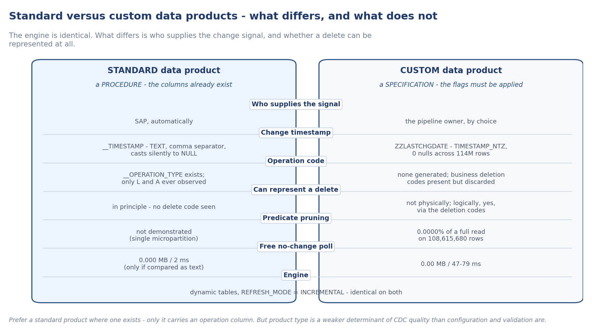

# How it works

This document covers what is common to both CDC tracks: why the platform refuses standard CDC mechanisms, why dynamic tables with `REFRESH_MODE = INCREMENTAL` are the engine on both tracks, and the connector merge precondition that makes incremental refresh viable. For deployment steps, see [deployment.md](deployment.md).

**Two tracks, two documents.** An SAP BDC catalog-linked share can carry standard data products, custom data products, or both at once. The tracks are not interchangeable - the signals differ, the validation steps differ, and the action required to close the delete gap differs. Classify each object individually before deploying capture.



| Track | What SAP provides | Starting document |
| --- | --- | --- |
| Standard | Four connector-generated columns (`__OPERATION_TYPE`, `__TIMESTAMP`, `load_type_<hash>`, `run_id_<hash>`) | [standard-products-cdc.md](standard-products-cdc.md) - a procedure you follow step by step |
| Custom | Only what the pipeline owner chose to include - typically one replication timestamp field | [custom-products-cdc.md](custom-products-cdc.md) - a specification of what to ask for and why |

On both tracks, the engine of choice is dynamic tables with `REFRESH_MODE` pinned to `INCREMENTAL`. The watermark procedure (`sql/04` for the custom track, `sql/05` for the standard track) is the trigger and the exception path; it is not the engine.

---

## The share and its apparent nature

A catalog-linked database created by SAP BDC Connect reports `kind = TABLE` and `is_external = N` on every object inside it. `SHOW TABLES` and `INFORMATION_SCHEMA` agree. Both are incomplete descriptions.

The objects are Iceberg tables whose catalog is managed by SAP, not by Snowflake. Snowflake can read them but does not own their metadata lifecycle. The distinction becomes visible only when you try to attach a change mechanism.

Three behaviours are worth knowing before you start:

- `INFORMATION_SCHEMA.COLUMNS` returns no rows for a catalog-linked database. `DESCRIBE TABLE` is the only route to a column list, one statement per object. There is no bulk alternative.
- Schema names contain a colon (for example `"dp_finance_v2_srv:v1"`) and object names are mixed case. Every reference in SQL must be double-quoted.
- A share can advertise a table that has never been materialised. `DESCRIBE TABLE` on such an object fails with `table 'refresh_table' is not initialized`. That is a property of the share, not a fault in the caller. Tooling must tolerate the per-object failure and continue. The probe handles this already.

---

## What the platform refuses

The three standard CDC mechanisms Snowflake offers are all unavailable, for one shared reason - the catalog is external:

| You attempt | Error |
| --- | --- |
| `CREATE STREAM ... ON TABLE <share_object>` | *Streams on External Tables or Iceberg tables with an external catalog must have INSERT_ONLY set to true.* |
| `SELECT ... CHANGES(INFORMATION => DEFAULT)` | *CHANGES clause is not supported on external tables or Iceberg tables with an external catalog.* |
| `ALTER TABLE ... SET CHANGE_TRACKING = TRUE` | *change_tracking cannot be set for Iceberg tables unless they use Snowflake catalog.* |

**`SHOW TABLES` reports `change_tracking = ON` on standard data product objects.** This is misleading. Despite that value, both streams (other than `INSERT_ONLY`) and the `CHANGES()` clause are still refused on the reference account with the same errors as on custom-track objects. `change_tracking = ON` in `SHOW TABLES` output does not indicate that Snowflake CDC mechanisms will work on these objects. Do not use it as the basis for a deployment decision.

**INSERT_ONLY stream.** A stream with `INSERT_ONLY = TRUE` is permitted. It creates successfully and positions at the current state, returning zero rows at creation. It sees inserts and updates but cannot detect physical deletes - that requires comparing two source snapshots, which INSERT_ONLY mode does not do. The 14-day staleness window applies: an unread stream expires after that period. The same procedural code required here is also required for the watermark path, but with less capability and an additional staleness risk. There is no situation in which the INSERT_ONLY stream path is preferable to the watermark path.

**Metadata columns.** `METADATA$ACTION`, `METADATA$ISUPDATE`, and `METADATA$ROW_ID` do not resolve on catalog-linked objects. `METADATA$FILENAME` works and exposes the underlying Parquet file paths.

**Time travel.** `DATA_RETENTION_TIME_IN_DAYS` is fixed at 1 on the catalog-linked objects and cannot be altered. Time travel is unavailable at 36 hours. `AT(OFFSET => ...)` for historical comparisons on source objects beyond 24 hours is not available.

---

## The connector merge precondition

The incremental pattern on both tracks rests on one observable property of the BDC connector: it merges rather than reloads. Historical rows keep their original replication timestamp while new data arrives in new Parquet files. Because the connector writes the replication timestamp in monotonic batches, per-file Iceberg statistics eliminate every file that cannot contain a match when a watermark predicate is applied.

If the connector reloaded on every cycle - writing every row with a fresh timestamp each time - the watermark window would cover the entire object on every run, and incremental refresh would be a full scan by another name.

**This is a measured property, not a documented guarantee.** Verify it on your own tenant before deploying. The query in `sql/00_discover.sql` (step 6) groups rows by write day. The shape to look for is several distinct write days with the bulk of rows on the initial load and small incremental additions since. A single write day covering all rows means the connector either loaded once or reloads fully. Neither supports an incremental watermark.

The connector merge behaviour was confirmed on both reference tenants:

- On the custom-track tenant, `ZZLASTCHGDATE` grouped into 5 distinct write days with 100.0000% of rows on the initial load and small deltas since. Day-2 and day-3 deltas included retroactive updates to rows originally created in prior months, confirming that the connector does not deliver append-only data. A watermark MERGE must handle retroactive updates by matching on the business key, not by appending.
- On the standard-track tenant, `load_type_<hash>` carried `initial` and `delta` values side by side, which is the same conclusion by a more direct route.

A `NOT READY` result on `signal.merge_or_reload` from the readiness probe means the incremental watermark path is not viable on that object. Dynamic tables produce a correct result regardless - they diff consecutive snapshots without depending on the watermark predicate.

---

## REFRESH_MODE = INCREMENTAL: the engine on both tracks

Dynamic tables with `REFRESH_MODE = INCREMENTAL` were verified to accept incremental refresh over catalog-linked shares. A no-change cycle returns `REFRESH_ACTION = NO_DATA` in a few hundred milliseconds without reading any source data.

**State `REFRESH_MODE = INCREMENTAL` explicitly.** Never leave it as `AUTO`. `AUTO` allows Snowflake to silently fall back to `FULL` when it cannot support incremental for a given query. A full refresh produces no error, no warning, and is indistinguishable from an incremental one in the object's apparent behaviour - only the cost differs. Stating `INCREMENTAL` converts a silent cost regression into a deployment-time error.

**The cascade.** A dynamic table in `FULL` mode disables change tracking on itself, which forces every downstream dynamic table that reads it to `FULL` as well. On the custom-track reference tenant, before `REFRESH_MODE` was pinned explicitly, Snowflake chose `FULL` on several tables and cascaded it. After pinning, 10 of 10 Gold dynamic tables ran `INCREMENTAL`.

Confirm the setting used after each table is created:

```sql
SHOW DYNAMIC TABLES IN SCHEMA <L2_DB>.<SCHEMA>;
-- Expected: refresh_mode = INCREMENTAL, refresh_mode_reason IS NULL
```

A non-null `refresh_mode_reason` means Snowflake fell back to `FULL` despite the instruction. Investigate before proceeding.

---

## The four verified query shapes

Dynamic tables with `REFRESH_MODE = INCREMENTAL` were tested over a catalog-linked share across four query shapes (custom track, reference tenant). All four were accepted as incremental, with `refresh_mode_reason = null`. No-change refreshes returned `REFRESH_ACTION = NO_DATA` in the durations shown:

| Shape | Description | NO_DATA duration |
| --- | --- | --- |
| A | Flat projection over a view that casts dates | 348 ms |
| B | Join of two views | 486 ms |
| C | GROUP BY aggregate | 450 ms |
| D | Left join to a pre-aggregated child CTE | 570 ms |

The SQL for each shape is in `sql/02_dynamic_table_engine.sql`. These shapes cover the query patterns that appear most often in a SAP BDC Gold layer and can be used as templates.

---

## What blocks incremental refresh

Any non-deterministic expression inside a dynamic table's defining query forces a full refresh on every cycle, regardless of whether the source has changed. `CURRENT_DATE()`, `CURRENT_TIMESTAMP()`, and `RANDOM()` are the common cases. Month-to-date logic is the most frequent source of this problem in practice.

The correct pattern is to put time-relative logic in a view over the dynamic table rather than inside it:

```sql
-- Do NOT put this inside the dynamic table:
--   WHERE SALESDOCUMENTDATE >= DATE_TRUNC('month', CURRENT_DATE())

-- Define a view over the dynamic table instead:
CREATE OR REPLACE VIEW <L2_DB>.<SCHEMA>.VW_MONTH_TO_DATE AS
SELECT *
FROM   <L2_DB>.<SCHEMA>.DT_SO_LINE
WHERE  SALESDOCUMENTDATE >= DATE_TRUNC('month', CURRENT_DATE());
```

The view is always current, adds no refresh cost, and leaves the dynamic table incrementally refreshable. This pattern is included in `sql/02_dynamic_table_engine.sql`.

Symptom of the problem: `REFRESH_ACTION = FULL` appearing in `VW_REFRESH_AUDIT` in steady state (not just on the first cycle, which is always `INCREMENTAL`). Confirm with `refresh_mode_reason` from `SHOW DYNAMIC TABLES`.

---

## Choosing a mechanism

| | Dynamic table | Watermark + MERGE | INSERT_ONLY stream |
| --- | --- | --- | --- |
| Inserts | yes | yes | yes |
| Updates | yes | yes | yes |
| Physical deletes | yes - diffs snapshots | custom track: no (no operation column). standard track: structurally possible, unverified - see [standard-products-cdc.md](standard-products-cdc.md) | no - by definition |
| Cheap no-change detection | yes (`NO_DATA`) | yes (0 MB from manifest statistics on both tracks) | yes |
| Code required | none | task + control table + MERGE | task + MERGE |
| Can feed targets outside Snowflake | no | yes | yes |
| Goes stale if unread | no | no | yes, 14 days |
| Blocked by non-deterministic SQL | yes | no | no |

**Use dynamic tables on both tracks.** They are the only mechanism that reliably handles physical deletes, and they require no code. Reserve the watermark path for the two cases dynamic tables cannot serve: a transformation containing a non-deterministic expression, and a target outside Snowflake.

The watermark's more useful role is as a **trigger** rather than an engine. Polling it is free on both tracks - 0.00 MB on the custom track, 0.000 MB on the standard track - so a task can check whether the source moved and refresh a dynamic table only when it did, instead of refreshing on a fixed schedule and discovering nothing changed.

Regardless of mechanism, schedule row-count reconciliation between source and target for every monitored object on both tracks. Physical deletes are invisible on the custom-track watermark path. On the standard track, no delete code was observed on the reference share; their presence on any specific tenant and product is unverified.

---

## Freshness measurement

Use `SYSDATE()` for the current-time reference in any freshness or lag calculation. `CURRENT_TIMESTAMP()` is session-timezone-aware; on a UTC-7 session it reported a real 109-minute lag as -311 minutes when mixed with a UTC watermark. `SYSDATE()` returns UTC as `TIMESTAMP_NTZ` regardless of session timezone. This applies to both tracks.

---

## Open questions

These items were not resolved in the reference measurement windows. They are stated here as open, not settled.

**1. The authoritative `__OPERATION_TYPE` value enumeration (standard track).**

Only `L` (initial load) and `A` (delta after-image) were observed on the reference standard-track share across all non-empty objects. Whether a standard data product ever emits a delete code is unknown. The SAP Help documentation for this column is JavaScript-rendered and could not be retrieved; a web search surfaced only the SAP Datasphere BigQuery adapter documentation, which covers a different target system and must not be cited as authority for this. The probe discovers and reports the actual distribution per tenant rather than assuming an enumeration. See [gaps-and-asks.md](gaps-and-asks.md) for the ask to SAP.

**2. What a changed-source dynamic table refresh produces on a production-scale custom-track object.**

On the standard track, `REFRESH_ACTION = INCREMENTAL SUCCEEDED` was observed after a watermark advance on a 3,355-row table. The equivalent on a multi-million-row custom-track object - `REFRESH_ACTION = INCREMENTAL` with `ROWS_INSERTED` matching the connector delta count - was not observed in the available window. After your next connector write on the custom track, query `VW_REFRESH_AUDIT` and record the result. If `REFRESH_ACTION = FULL` appears, the measured fallback is the watermark path in `sql/04_watermark_exception_path.sql`.

Neither of these gaps changes the recommendation. The design is not contingent on either being settled in a particular way.
